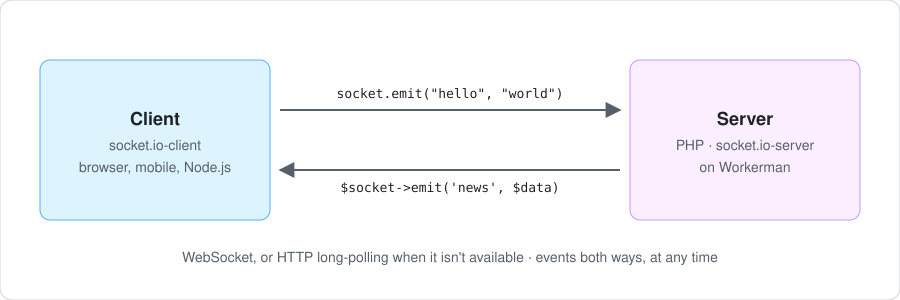

# socket.io-server

[](https://github.com/marcosmarcolin/socket.io-server/actions/workflows/ci.yml)
[](https://packagist.org/packages/marcosmarcolin/socket.io-server)
[](https://packagist.org/packages/marcosmarcolin/socket.io-server)
[](https://packagist.org/packages/marcosmarcolin/socket.io-server)

A [Socket.IO](https://socket.io) v4 server for PHP, built on [Workerman](https://github.com/walkor/workerman).

It speaks the current protocols, Engine.IO v4 and Socket.IO v5, so browsers and apps use the official `socket.io-client` v3 or v4. It passes the official Engine.IO and Socket.IO compliance suites, and CI runs it against the official client.



> **Version 0.x.** The API may still change between minor versions until 1.0; each change is listed in the [changelog](CHANGELOG.md).

## Features

- HTTP long-polling and WebSocket on one port, with the upgrade from polling to WebSocket.
- Namespaces, middlewares, rooms, acknowledgements (broadcasts with a timeout too), binary data and catch-all listeners.
- Connection state recovery: a client that lost its connection gets its socket, rooms and missed events back.
- Several processes and machines, through [workerman/channel](https://github.com/walkor/channel) or Redis.
- An `Emitter` that sends to the clients from any PHP code, such as a PHP-FPM request.
- CORS with cookies, a hook to refuse connections before the handshake, and TLS.
- Compression of polling answers and WebSocket messages, and a debug log.
- The official [Admin UI](https://socket.io/docs/v4/admin-ui/): live sockets, rooms and events, and actions on them.
- About 24 KB per connection: 10,000 WebSocket clients in one process take 250 MB, less than the official Node.js server's 290 MB (see [Performance and limits](docs/performance.md)).
- An API shaped like [phpsocket.io](https://github.com/walkor/phpsocket.io)'s, to ease migration.

## Compatibility

| | |
|---|---|
| Protocols | Engine.IO v4 and Socket.IO v5 |
| Clients | `socket.io-client` v3 and v4; CI runs 4.8.4 over HTTP long-polling, WebSocket and the upgrade. Other clients of these protocols, such as the official Java and Swift ones, should work, but aren't tested here. |
| Conformance | the official [Engine.IO](https://github.com/socketio/socket.io/tree/main/docs/engine.io-protocol/v4-test-suite) (25 of 25) and [Socket.IO](https://github.com/socketio/socket.io/tree/main/docs/socket.io-protocol/v5-test-suite) (32 of 32) test suites, on every pull request |
| Not supported | `socket.io-client` 1.x and 2.x (Engine.IO v3): use [workerman/phpsocket.io](https://github.com/walkor/phpsocket.io) |

## Requirements

- PHP 8.1 or later, with the `json` extension, and `pcntl` and `posix` to run Workerman.
- [Workerman](https://github.com/walkor/workerman) 5.2, and the `event` extension for more than about 1,000 connections per process; Swoole's event loop works too (see [Performance and limits](docs/performance.md)).
- On the client: `socket.io-client` v3 or v4. For the 1.x and 2.x clients, use [workerman/phpsocket.io](https://github.com/walkor/phpsocket.io).

## Installation

```sh
composer require marcosmarcolin/socket.io-server
```

## Quick start

`server.php`:

```php
<?php

use Marcolin\SocketIO\Socket;
use Marcolin\SocketIO\SocketIO;
use Workerman\Worker;

require __DIR__ . '/vendor/autoload.php';

$io = new SocketIO(3000, ['cors' => ['origin' => ['https://example.com']]]);

$io->on('connection', function (Socket $socket) use ($io): void {
    $socket->join('lobby');
    $socket->emit('hello', 'world');

    // A Closure as the last argument is the client's acknowledgement callback.
    $socket->on('chat', function (string $message, ?Closure $ack = null) use ($io): void {
        $io->to('lobby')->emit('chat', $message);
        if ($ack !== null) {
            $ack('delivered');
        }
    });
});

Worker::runAll();
```

Run it with `php server.php start` (`start -d` to run in the background, `stop`, `restart`, `status`: the usual Workerman commands). Then, on the client:

```js
import { io } from "socket.io-client";

const socket = io("http://localhost:3000");

socket.on("hello", (word) => console.log(word));
socket.on("chat", (message) => console.log(message));
socket.emit("chat", "hi", (status) => console.log(status)); // "delivered"
```

## Examples

Each one runs with `php examples/<name>/start.php start`; then open http://localhost:3001. Each folder's README says what to try and how it works.

| Example | Shows |
|---|---|
| [chat](examples/chat) | a chat room: names, typing indicator, join and leave notices, and users who come back after a dropped connection with the messages they missed |
| [admin-ui](examples/admin-ui) | the chat, watched and driven live from the official Admin UI |
| [session-auth](examples/session-auth) | login with a PHP session, and a middleware that lets in only logged-in sessions' sockets |
| [private-messaging](examples/private-messaging) | private messages to every tab of a user through a room per user, sessions kept across reconnections, and who is online |
| [rooms](examples/rooms) | `join`, `leave`, messages to a room, live member lists, and the list of rooms from the adapter's room events |
| [acks](examples/acks) | acknowledgements both ways, and the server's `timeout()` |
| [namespaces](examples/namespaces) | `/public` and `/admin`, a middleware with a token, `ConnectionError` |
| [binary](examples/binary) | file upload and download with `Binary` |
| [pong](examples/pong) | multiplayer Pong: a queue pairs players, one room per match, the game loop on the server at 30 frames a second with `volatile` state |
| [arena](examples/arena) | a multiplayer space arena: everyone in one room, bots while few play, a scoreboard, touch controls, and ships kept for players whose connection drops |
| [dashboard](examples/dashboard) | live dashboards: a server timer pushes new numbers every few seconds to the viewers of each one |
| [multi-process](examples/multi-process) | four processes and `ChannelAdapter` |
| [emitter](examples/emitter) | a plain PHP endpoint sending notifications to the clients with the `Emitter`; it needs a Redis server |
| [redis](examples/redis) | four processes and `RedisAdapter`; it needs a Redis server |

## Documentation

- [Configuration](docs/configuration.md): server options, CORS and cookies, refusing connections, TLS.
- [API reference](docs/api.md): `SocketIO`, namespaces, sockets, acknowledgements, broadcasting, JSON and binary data.
- [Several processes](docs/multiple-processes.md): `ChannelAdapter`, `RedisAdapter`, and the `Emitter`.
- [Behind a reverse proxy](docs/reverse-proxy.md): nginx and HAProxy, TLS, and sticky sessions for polling.
- [Admin UI](docs/admin-ui.md): watching and acting on the server from the official Admin UI.
- [Performance and limits](docs/performance.md): what a process holds, the `event` extension, and the load test.
- [Migrating from phpsocket.io](docs/migrating-from-phpsocket.io.md): moving an app and its clients.
- [Development](docs/development.md): tests, linters and the compliance suites, all in Docker.
- [Changelog](CHANGELOG.md).

## License

MIT
